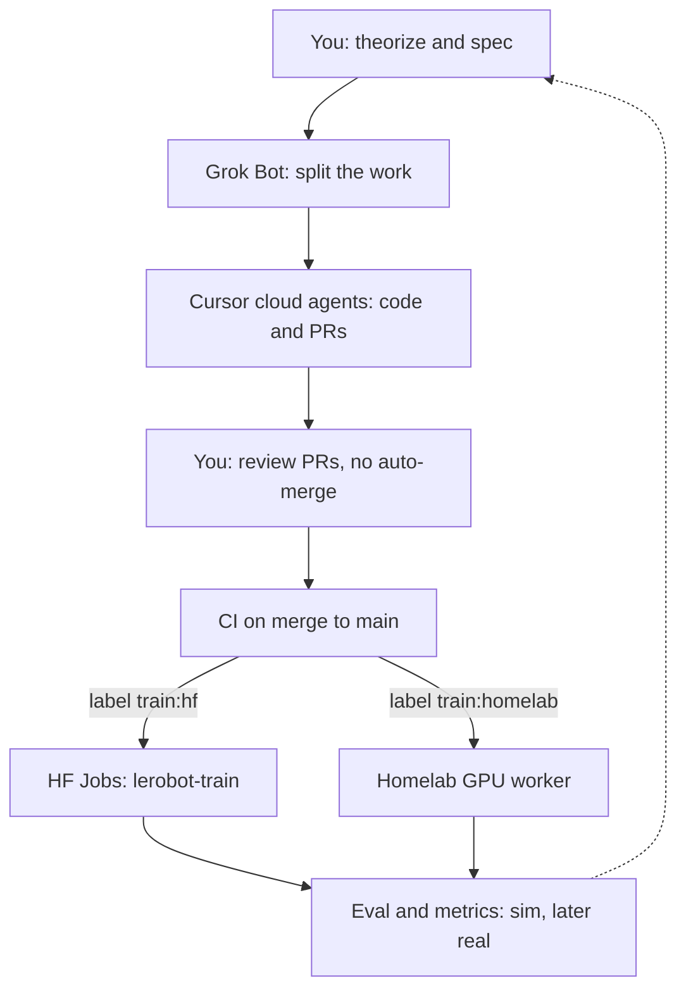

# xlerobot-research

Imitation and reinforcement-learning research for [XLeRobot](https://github.com/Vector-Wangel/XLeRobot), the low-cost dual-arm mobile manipulator built on [LeRobot](https://github.com/huggingface/lerobot). This repository is the scaffold: a CPU MuJoCo env, ACT configs for LeRobot 0.6.1, and GitHub Actions that route a merged pull request to Hugging Face Jobs or a homelab GPU.

Pull requests are reviewed by a person. Nothing here auto-merges.

## Workflow



Results come back as a public Hugging Face model card plus `eval_metrics.json`. The next spec is written by a person who reads those artifacts. Details: [docs/architecture.md](docs/architecture.md).

## Stack

| Piece | Choice |
| --- | --- |
| Imitation | LeRobot **0.6.1** ACT (`policy.type=act`), CLI `lerobot-train` |
| HF training | `lerobot-train --job.target=a10g-small` on image `huggingface/lerobot-gpu:latest` |
| Homelab | Self-hosted runner labels `self-hosted` and `xlerobot-gpu` (the K3s worker) |
| Sim | MuJoCo `>=3.3,<3.6` CPU wheel, gymnasium `XLeRobot-v0` |
| Robot reference | [XLeRobot MuJoCo MJCF](https://github.com/Vector-Wangel/XLeRobot/blob/main/simulation/mujoco/xlerobot.xml) (Apache-2.0). Meshes are not vendored; the checked-in model is a placeholder. |
| Hub | Public model repo `Jacob-Brokloff/xlerobot-act` |
| License | MIT for this repo. Upstream XLeRobot kinematics are Apache-2.0; see `NOTICE`. |

## Layout

```
envs/xlerobot_mujoco/     gymnasium env and placeholder MJCF
configs/                  LeRobot 0.6.1 ACT YAML
scripts/                  train, sim eval, model card, PPO stub, upstream fetch
docs/                     architecture, sim, training, RL, labels
.github/workflows/        smoke CI, merge routing, manual HF and homelab kicks
.github/labels.yml        train:hf and train:homelab
```

## Local smoke test

Python 3.12. No GPU.

```bash
python3.12 -m venv .venv
source .venv/bin/activate
pip install -e ".[dev]"
ruff check envs scripts tests
pytest -q
python scripts/eval.py --episodes 1 --steps 5
python scripts/train.py --route hf --dry-run
```

`pytest` imports the env and steps the MJCF. It does not install LeRobot or call the Hub.

Install the trainer only on a machine that will actually train:

```bash
pip install -e ".[train]"
```

## Labels

| Label | Meaning |
| --- | --- |
| `train:hf` | On merge, plan a Hugging Face Jobs run (`lerobot-train`, config `configs/act_xlerobot_hf_job.yaml`). |
| `train:homelab` | On merge, plan a self-hosted GPU run (`configs/act_xlerobot_homelab.yaml`). |

Create the labels once (CI will not create them):

```bash
gh label create "train:hf" \
  --repo Jacob-Brokloff/xlerobot-research \
  --description "On merge, route training to Hugging Face Jobs (lerobot-train)." \
  --color 1F6FEB

gh label create "train:homelab" \
  --repo Jacob-Brokloff/xlerobot-research \
  --description "On merge, route training to the homelab self-hosted GPU runner." \
  --color 238636
```

Put at most one of them on a PR. Both labels fail the route step. No label means the merge does not train. More detail: [docs/labels-and-secrets.md](docs/labels-and-secrets.md).

## Add HF_TOKEN and kick a train:hf job

Do this when a demonstration dataset exists. The checked-in dataset id `Jacob-Brokloff/xlerobot-demo` is a placeholder.

1. Create a Hugging Face token with **write** access to the model repo you will publish (`Jacob-Brokloff/xlerobot-act`, unless you change `policy.repo_id`). Fine-grained write on that repo is enough for the model card. Dataset upload needs write on the dataset repo too. https://huggingface.co/settings/tokens
2. In this GitHub repo open **Settings → Secrets and variables → Actions → New repository secret**.
3. Name the secret `HF_TOKEN`. Paste the token. Do not commit it and do not put it in a YAML file.
4. Create the labels above if they are not there yet.
5. Collect a LeRobot dataset and set `dataset.repo_id` in `configs/act_xlerobot_hf_job.yaml` to that dataset.
6. Confirm the GPU flavor and price with `hf jobs hardware`. The config uses `a10g-small`. Change `job.target` if you want a different flavor. https://huggingface.co/docs/lerobot/hardware_guide
7. Open a pull request that contains the config you want trained. Add the `train:hf` label. Review it. Merge it yourself. Leave auto-merge off.
8. The **Train on merge** workflow prints the `lerobot-train` command. It does **not** submit a job until you opt in:
   - **Settings → Secrets and variables → Actions → Variables**
   - Name: `XLEROBOT_DISPATCH_HF`
   - Value: `true`
9. Merge another `train:hf` PR, or skip the label path and run the workflow by hand: **Actions → Train HF → Run workflow**. That button submits a real HF Job. It needs `HF_TOKEN`, the training extra, and a dataset. `job.detach=true`, so the GitHub runner returns after submit; the log stream is on the Hugging Face job page.

LeRobot forwards `HF_TOKEN` into the job. On success the policy repo receives `config.json`, `model.safetensors`, and `train_config.json`.

Publish or refresh the research model card after you have metrics:

```bash
python scripts/eval.py --episodes 2 --steps 20
HF_TOKEN=... python scripts/publish_model_card.py --metrics outputs/eval/metrics.json --push
```

`--push` creates a **public** model repo if needed and uploads `README.md`. Omit `--push` to write `outputs/model_card/README.md` only.

## Homelab route

1. Register a self-hosted runner with labels `self-hosted` and `xlerobot-gpu`. The intended host is the homelab K3s cluster. The cluster manifests are not in this repo; the workflow file is the contract.
2. Do not run **Train homelab** until that runner is online. The job waits in the queue otherwise.
3. The runner is trusted: the workflow passes `HF_TOKEN` to it so the policy can be uploaded.
4. Opt in with repository variable `XLEROBOT_DISPATCH_HOMELAB=true`, then merge a PR labeled `train:homelab`. Or run **Actions → Train homelab** yourself.

`job.target` stays `local` on this route. The GPU is the runner, not an HF Jobs flavor.

## ACT, eval, and RL

ACT field notes and the three YAML files: [docs/training.md](docs/training.md).

The MJCF is a placeholder (joint names and ranges from upstream, primitive geoms, no STL meshes): [docs/simulation.md](docs/simulation.md). Fetch the Apache-2.0 meshes with `scripts/fetch_upstream_mjcf.sh` when you are ready to swap the model. That script does not change the env.

RL is PPO in sim first, then LeRobot HIL-SERL after the robot exists. `python scripts/train_ppo.py` exits without training. [docs/rl-track.md](docs/rl-track.md).

## CI

| Workflow | When |
| --- | --- |
| [CI](.github/workflows/ci.yml) | Pull request and push to `main`. Ruff and `pytest` (import env, load MJCF, step). |
| [Train on merge](.github/workflows/train-on-merge.yml) | A PR merged into `main`. Routes on `train:hf` / `train:homelab`. |
| [Train HF](.github/workflows/train-hf.yml) | Manual. Submits the HF job. |
| [Train homelab](.github/workflows/train-homelab.yml) | Manual, or dispatched from the merge workflow after opt-in. |

Suggested branch protection, not applied by this repo: require the smoke check, require a pull request, leave auto-merge disabled.
