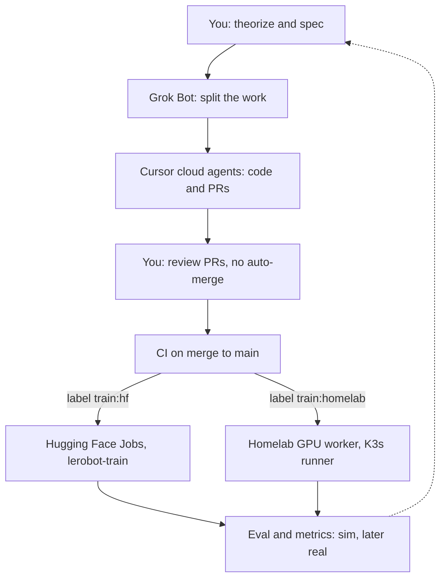

# Architecture

The research loop is a human review gate with two training backends. Nothing in this repo auto-merges a pull request.

The dashed return path is a person reading the Hub model card and the eval JSON, then writing the next spec. There is no bot webhook in this scaffold.

## What each box does today

| Step | Where it lives |
| --- | --- |
| Spec | Issues, chats, papers. Not stored as code. |
| Code | This repo. Cloud agents open PRs. |
| Review | GitHub. Merge is manual. |
| Route | `.github/workflows/train-on-merge.yml` reads labels on the merged PR. |
| HF train | `lerobot-train` with `configs/act_xlerobot_hf_job.yaml`. LeRobot 0.6.1 submits the job when `--job.target` is an HF flavor. |
| Homelab train | `.github/workflows/train-homelab.yml` on a self-hosted runner labeled `self-hosted` and `xlerobot-gpu`. |
| Sim eval | `python scripts/eval.py` rolls out a random policy in `XLeRobot-v0`. |
| Real eval | Not implemented. |
| Publish | `lerobot-train` pushes the policy when `push_to_hub` is true. `scripts/publish_model_card.py` writes the README model card. |

## Package

`envs/xlerobot_mujoco` is the installable package. Training configs and GitHub workflows stay outside it so LeRobot can read the YAML without importing MuJoCo, and so CI can show the route without a GPU.

The gymnasium env is not yet a LeRobot `EnvConfig`. `env_eval_freq` is 0 in the ACT configs for that reason. Sim metrics come from `scripts/eval.py` until a LeRobot env wrapper exists.

## Dispatch switch

Label routing always prints a plan on merge. A real submit also requires:

- `train:hf` and repository variable `XLEROBOT_DISPATCH_HF=true` and secret `HF_TOKEN`, or
- `train:homelab` and repository variable `XLEROBOT_DISPATCH_HOMELAB=true` and an online runner.

A person can also run the **Train HF** workflow by hand. That workflow does not check the label. It does require `HF_TOKEN`.
